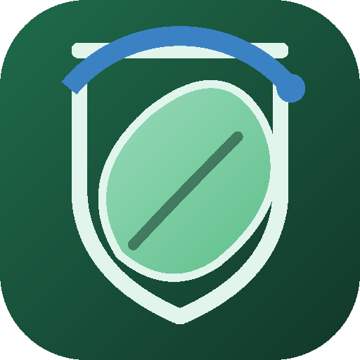
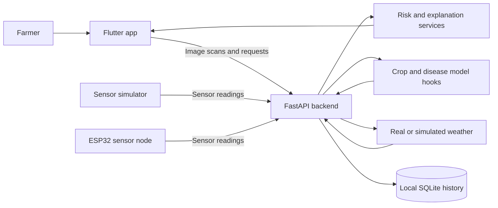

<div align="center">
  
  <h1>🌱 AgriSentry AI</h1>
  <p><strong>See the crop. Understand the conditions. Decide what to do next.</strong></p>
  <p>
    
    
    
  </p>
</div>

AgriSentry AI is a crop-monitoring prototype that brings leaf scans, local sensor readings, weather context, and practical explanations into one place. Start with the software simulator; connect an ESP32 sensor node when you are ready.

> **Prototype status:** Disease and crop model integration points are included. Until trained model files are supplied, the backend labels uncertain or unavailable predictions instead of presenting them as confirmed diagnoses. Weather and sensor readings identify whether their source is real or simulated.

## 🌾 What it can do

- **Scan a leaf:** Send a crop image to the backend for image-quality checks and analysis.
- **Read growing conditions:** Use live ESP32 readings or a simulated sensor feed for temperature, humidity, soil moisture, and light.
- **Assess environmental risk:** Combine available sensor and weather context into a risk estimate.
- **Explain recommendations:** Show the factors behind an assessment and practical next steps.
- **Review activity:** Keep scan and sensor history available to the app.
- **Train the tomato model:** Use the training workflow in [`ai/TRAINING_GUIDE.md`](ai/TRAINING_GUIDE.md) when you have the dataset and training dependencies.

## 🧭 How the pieces fit



## 🚀 Run the software MVP

You need Python, Flutter, and an Android emulator or device. Hardware is optional. Open PowerShell at the repository root.

### 1. Start the backend

```powershell
Set-Location backend
py -3 -m venv .venv
.\.venv\Scripts\python.exe -m pip install --upgrade pip
.\.venv\Scripts\python.exe -m pip install -r requirements.txt
.\.venv\Scripts\python.exe -m uvicorn app.main:app --reload --host 0.0.0.0 --port 8000
```

The default weather mode is simulated, so the backend can start without an API key. Interactive API documentation is at [http://localhost:8000/docs](http://localhost:8000/docs).

### 2. Send simulated sensor readings

Open a second PowerShell window at the repository root:

```powershell
.\backend\.venv\Scripts\python.exe integration\test_data\simulate_sensor.py --url http://localhost:8000 --interval 10
```

### 3. Run the Flutter app

Open a third PowerShell window:

```powershell
Set-Location mobile
flutter pub get
flutter run --dart-define=API_BASE_URL=http://10.0.2.2:8000
```

`10.0.2.2` lets the Android emulator reach the backend on your Windows computer. For a physical phone, use your computer's LAN IP address and keep the backend bound to `0.0.0.0`.

### 4. Check the API

With the backend running, use another terminal from the repository root:

```powershell
.\backend\.venv\Scripts\python.exe integration\api_tests\test_api.py
```

## 🧠 Model and dataset

The AI code is organized under `ai/`:

- `ai/inference/` — prediction code
- `ai/preprocessing/` — image preparation
- `ai/training/` — training pipeline
- `ai/models/labels.txt` — label order

The training datasets and generated model weights are kept out of GitHub to avoid committing large data and binary artifacts. Follow [`ai/TRAINING_GUIDE.md`](ai/TRAINING_GUIDE.md) to prepare a dataset and train a model. A trained artifact must be present and the backend integration verified before describing predictions as trained or field-ready.

## 🔌 Connect an ESP32 later

The firmware and wiring notes are in [`hardware/`](hardware/). The ESP32 sends readings to the same `/api/sensors/data` endpoint as the simulator. Set its backend URL to your computer's LAN address; `localhost` on the ESP32 points to the board itself.

## 🗺️ API at a glance

| Method | Endpoint | What it does |
|---|---|---|
| `GET` | `/api/health` | Backend health check |
| `POST` | `/api/analyze` | Analyze a submitted crop image |
| `POST` | `/api/sensors/data` | Receive sensor readings |
| `GET` | `/api/sensors/latest` | Return the latest sensor reading |
| `GET` | `/api/sensors/history` | Return sensor history |
| `GET` | `/api/weather/current` | Return weather context with its source labeled |
| `POST` | `/api/risk/assess` | Assess environmental risk |
| `POST` | `/api/future-risk/estimate` | Generate a prototype 24/48/72-hour estimate |
| `POST` | `/api/explain` | Explain an assessment |
| `POST` | `/api/recommend` | Return recommended next steps |
| `GET` | `/api/history` | Return scan history |

## 🗂️ Project map

```text
ai/           Image inference, preprocessing, and model training
backend/      FastAPI services, API routes, and local database
hardware/     ESP32 firmware, wiring, and parts list
integration/ API checks, simulator, and MVP checklist
mobile/       Flutter application
```

## 🔐 Configuration

Copy `backend/.env.example` to `backend/.env` only when you want to change the defaults. For live weather, set `WEATHER_MODE=real` and provide a `WEATHER_API_KEY`. Keep `.env` and other credentials private; the repository `.gitignore` excludes them.

## ⚠️ Prototype notes

AgriSentry AI is a development project. Simulated inputs are labeled, model outputs depend on locally supplied weights, and prototype risk estimates need field evaluation before being relied on for crop decisions.

## 📚 More project notes

- [MVP checklist](integration/documentation/MVP_CHECKLIST.md)
- [AI dataset plan](ai/DATASET_PLAN.md)
- [Tomato model training guide](ai/TRAINING_GUIDE.md)
- [Hardware guide](hardware/README.md)
